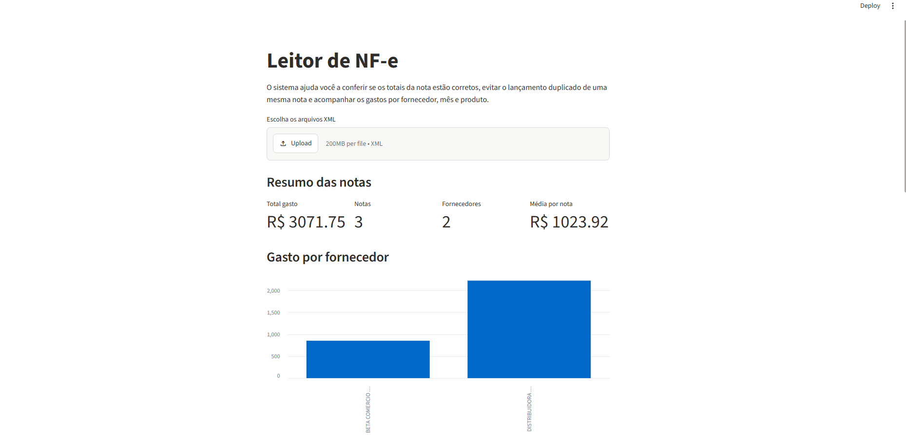
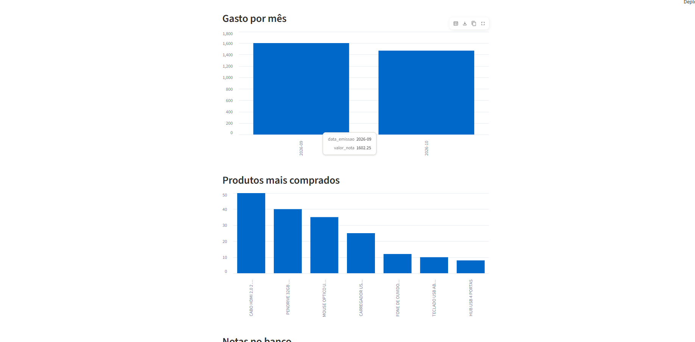

# Leitor de NF-e

Painel em Python que lê notas fiscais eletrônicas (arquivos XML), confere os totais, guarda tudo num banco de dados e mostra os gastos por fornecedor, por mês e por produto.

**Acesse online:** _(link do Streamlit Cloud, entra na parte 7.3)_





## O problema que ele resolve

Quem recebe muitas notas fiscais precisa conferir valores, evitar lançar a mesma nota duas vezes e saber para onde o dinheiro está indo. Fazer isso à mão, nota por nota, é lento e fácil de errar.

## O que o sistema faz

- Recebe vários XML de uma vez pelo navegador
- Lê fornecedor, CNPJ, número, data, produtos, frete e valor total de cada nota
- Grava as notas num banco SQLite e **não grava a mesma nota duas vezes** (confere a chave de acesso)
- Mostra indicadores: total gasto, quantidade de notas, fornecedores e média por nota
- Mostra gráficos de gasto por fornecedor, gasto por mês e produtos mais comprados
- Gera um relatório em Excel com as abas de notas e de itens (`gerar_relatorio.py`)

## Tecnologias

- **Python** com `xml.etree.ElementTree` para ler o XML da NF-e
- **pandas** para organizar e somar os dados
- **SQLite** para guardar as notas (tabelas de fornecedores, notas e itens, ligadas por chave estrangeira)
- **Streamlit** para o painel
- **pytest** para os testes

## Como rodar no seu computador

```bash
git clone https://github.com/buenor877-ux/leitor_nfe.git
cd leitor_nfe
python -m venv .venv
.venv\Scripts\activate
pip install -r requirements.txt
streamlit run app.py
```

Depois, envie os arquivos da pasta `notas_exemplo` pelo painel.

## Testes

```bash
pip install pytest
python -m pytest
```

Os testes conferem a leitura de uma nota, os totais de todas as notas (produtos + frete = valor da nota) e que uma nota repetida não é gravada no banco.

## Estrutura

```
leitor_nfe/
├── app.py              # painel em Streamlit
├── ler_nota.py         # lê um XML e devolve os dados da nota
├── banco.py            # cria as tabelas, grava e carrega as notas
├── gerar_relatorio.py  # gera o relatório em Excel
├── salvar_notas.py     # grava todas as notas da pasta no banco
├── notas_exemplo/      # 3 notas fictícias para teste
└── tests/              # testes com pytest
```

## Sobre os dados

As notas da pasta `notas_exemplo` são **fictícias**: as empresas e os CNPJs não existem. Notas reais têm dados de empresas e pessoas e não devem ser enviadas para o GitHub.

## Autor

**Leonardo Henrique Bueno**
[LinkedIn](https://www.linkedin.com/in/leonardohbueno/)
